  

<h3 align="center"><i>Welcome to my corner of the internet — where ideas get trained, tested and shipped. ✨</i></h3>

  

 

## 🔮 `whoami`

My name is **Rishika**, from the Sanskrit *Rishi* — a seer, someone who looks for the pattern underneath things.
That is pretty much how I approach technology: pull it apart, understand it from the core, and rebuild it myself.

I'm an **Electrical & Computer Engineering** student at **Thapar University** and currently a **Forward Deployed Engineering Intern at Pineyard AI**, shipping voice-calling agents and dashboards for enterprise clients. My work sits at the intersection of **Machine Learning** and **Generative AI** — from computer vision models to LLM-powered agents and production voice systems.

 

## 💼 Experience

<table>
  <tr>
    <td width="30%" valign="top">
      <b>Pineyard AI</b> 
      Forward Deployed Engineering Intern 
      🗓️ Jun 2026 – Present · Remote
    </td>
    <td width="70%" valign="top">
      Delivering client-specific agent logic and dashboards for enterprise clients including <b>RuPay</b> and <b>Testbook</b>, turning stakeholder calls into production configurations. Designed event-driven workflows that pair custom voice-calling agents with automated email, handling <b>100,000+ calls</b>, and integrated client websites and third-party REST APIs end to end.
    </td>
  </tr>
  <tr>
    <td width="30%" valign="top">
      <b>Deccan AI Labs</b> 
      AI &amp; Prompt Engineering Intern 
      🗓️ Feb 2026 – Mar 2026 · Remote
    </td>
    <td width="70%" valign="top">
      Built a systematic prompt re-engineering framework for <b>text-to-video generation</b> models, iterating on lighting, camera motion, temporal flow and subject behaviour to improve visual coherence and scene consistency.
    </td>
  </tr>
  <tr>
    <td width="30%" valign="top">
      <b>Hirely</b> 
      Machine Learning Intern 
      🗓️ Dec 2025 – Jan 2026 · Remote
    </td>
    <td width="70%" valign="top">
      Designed a two-tier job–candidate matching pipeline: <b>BERT embeddings</b> with cosine similarity for fast semantic retrieval, then <b>Mistral LLM re-ranking</b> for context-aware ordering. Added TF-IDF and Word2Vec skill extraction from raw resume text to sharpen recruiter search.
    </td>
  </tr>
  <tr>
    <td width="30%" valign="top">
      <b>Thapar University</b> 
      Student Research Intern 
      🗓️ Jun 2024 – Aug 2024 · Patiala
    </td>
    <td width="70%" valign="top">
      Implemented a <b>human activity recognition</b> pipeline combining <b>ViTPose++</b> pose estimation with a multi-layer LSTM for temporal modelling of spatiotemporal motion data.
    </td>
  </tr>
</table>

 

## ⚡ Tech Stack

<table align="center">
  <tr>
    <th align="left">Languages</th>
    <td></td>
  </tr>
  <tr>
    <th align="left">ML &amp; AI</th>
    <td></td>
  </tr>
  <tr>
    <th align="left">Backend &amp; Data</th>
    <td></td>
  </tr>
  <tr>
    <th align="left">Frontend</th>
    <td></td>
  </tr>
  <tr>
    <th align="left">Cloud &amp; Tools</th>
    <td></td>
  </tr>
</table>

Also: Hugging Face · LangChain · LangGraph · Gemini API · Whisper · BERT · RAG · pgvector · BullMQ · Keras · NumPy · Pandas · MLflow · Apache Spark · Airflow · Mem0 · Apify

 

## 🎯 Fun facts about me

- 🧠 I'd rather spend a weekend re-implementing a paper from scratch than reading three more about it.
- 📞 I like building things that *talk back* — voice agents, AI receptionists and call assistants are my favourite playground.
- 🎨 Clean interfaces matter to me as much as clean code — I sketch out the UI before the model.
- ☕ Debugging ritual: coffee, one terminal, and the firm belief that it's always the data.

 

## 🛠️ Featured Projects

<table>
  <tr>
    <td width="50%" valign="top">
      <b>CallFlow — AI Outreach Platform</b> 
      Multi-tenant REST API and 20+ BullMQ workers (Node.js, TypeScript, PostgreSQL, Redis) powering AI voice, WhatsApp and email outreach. Campaign dispatch engine with per-workspace pacing, retry ladders and idempotent telephony webhooks; LLM extraction of call intelligence and per-second credit billing.
    </td>
    <td width="50%" valign="top">
      <a href="https://github.com/Rishika004/Lingo"><b>Lingo — Agentic LinkedIn Post Generator</b></a> 
      5-agent LangGraph pipeline (Intake, Enrichment, RAG, Writer, Critic) that writes LinkedIn posts from GitHub repos, images or raw text. Matches your writing style by embedding past posts in Supabase pgvector and retrieving top examples at generation time.
    </td>
  </tr>
  <tr>
    <td width="50%" valign="top">
      <a href="https://github.com/Rishika004/self-healing-agnet"><b>Self-Healing Agent</b></a> 
      An autonomous agent that monitors its own pipeline, detects failures and recovers without human intervention.
    </td>
    <td width="50%" valign="top">
      <a href="https://github.com/Rishika004/ai-receptionist"><b>AI Receptionist</b></a> 
      A conversational receptionist that answers calls, understands intent and handles bookings end to end.
    </td>
  </tr>
  <tr>
    <td width="50%" valign="top">
      <a href="https://github.com/Rishika004/caller-karta"><b>Caller Karta</b></a> 
      AI-driven calling assistant that automates outbound calls and conversations in real time.
    </td>
    <td width="50%" valign="top">
      <a href="https://github.com/Rishika004/Voca-review"><b>Voca Review</b></a> 
      Voice-first review assistant that turns spoken feedback into structured, searchable insights.
    </td>
  </tr>
  <tr>
    <td width="50%" valign="top">
      <a href="https://github.com/Rishika004/fruit-freshness-detection-system"><b>Fruit Freshness Detection</b></a> 
      Real-time fruit detection with MobileNet and freshness classification using CNN and VGG-16. 92% accuracy, with a freshness index built from edge width and dark-spot analysis.
    </td>
    <td width="50%" valign="top">
      <a href="https://github.com/Rishika004/Machine-Learning-Based-Sheduler-Predictor"><b>ML Scheduler Predictor</b></a> 
      Random Forest model that picks the optimal CPU scheduling algorithm from arrival time, burst time and priority. 92.6% accuracy, F1 0.92, with a generated Gantt chart.
    </td>
  </tr>
  <tr>
    <td width="50%" valign="top">
      <a href="https://github.com/Rishika004/Humar-pose-estimation-deep--learning"><b>Human Pose Estimation</b></a> 
      Deep learning pipeline for detecting and tracking human body keypoints from images and video.
    </td>
    <td width="50%" valign="top">
      <a href="https://github.com/Rishika004/FACE-DETECTION-MODEL"><b>Face Detection</b></a> 
      Real-time face detection in images and video streams using Haar cascades with OpenCV.
    </td>
  </tr>
</table>

<a href="https://github.com/Rishika004?tab=repositories">see all repositories →</a>

 

## 🏆 Achievements

- 🥇 **Winner, Hack Eclipse** — ACM Student Chapter, TIET, 2024
- 🚀 **Semi-finalist, Flipkart Grid AI Challenge 2025** — top 80 of 2,000+ teams
- 🛰️ **ISRO Robotics Challenge 2025** — top 178 teams in India, Round 2

 

## 📬 How to reach me

  
  &nbsp;
  
  &nbsp;
  

 

## 📈 GitHub Stats

  
  

  

  <picture>
    <source media="(prefers-color-scheme: dark)" srcset="https://raw.githubusercontent.com/Rishika004/Rishika004/output/github-snake-dark.svg" />
    <source media="(prefers-color-scheme: light)" srcset="https://raw.githubusercontent.com/Rishika004/Rishika004/output/github-snake.svg" />
    
  </picture>

 

  Thanks for stopping by — <i>every model starts with a single question.</i>

